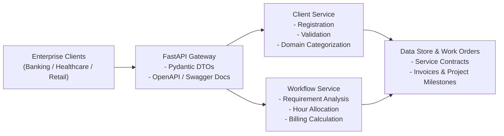

# 🏢 Enterprise Software Service & Workflow Platform

[](https://www.python.org/)
[](https://fastapi.tiangolo.com/)
[](https://www.docker.com/)
[](LICENSE)

An enterprise-scale software platform designed for **IT Services & Product Development (Pie Infotech)**. It streamlines client lifecycle onboarding, project requirement estimation, automated work-order generation, and technical documentation across key enterprise sectors including Banking, Healthcare, Retail, and ERP solutions.

---

## 🏗️ Architecture & Component Flow



---

## ✨ Engineering Highlights
- **Designing & Clean Architecture:** Modular separation of concerns into API routers, core schemas, business service layers, and automated testing suites.
- **Coding Standards:** PEP-8 compliant Python 3.11+, typed dataclasses, dependency injection, and asynchronous endpoint routing.
- **Testing & Verification:** Comprehensive PyTest / Unittest automated suite testing service constraints, domain fallbacks, and boundary conditions.
- **Content Writing & Documentation:** Exhaustive OpenAPI/Swagger technical specifications and developer architecture manuals.

---

## 🚀 Quickstart Guide

```bash
git clone https://github.com/arigisurendranaidu2005-code/enterprise-software-service-platform.git
cd enterprise-software-service-platform

python -m venv venv
source venv/bin/activate  # On Windows: venv\Scripts\activate

pip install -r requirements.txt
python -m unittest discover -s tests -v
uvicorn api.main:app --reload --port 8000
```
Interactive API docs available at: `http://localhost:8000/docs`

---

## 👤 Author
**Surendra Naidu Arigi**
- GitHub: [@arigisurendranaidu2005-code](https://github.com/arigisurendranaidu2005-code)
- LinkedIn: [SurendraNaiduArigi](https://linkedin.com/in/SurendraNaiduArigi)
- Email: arigisurendranaidu2005@gmail.com
